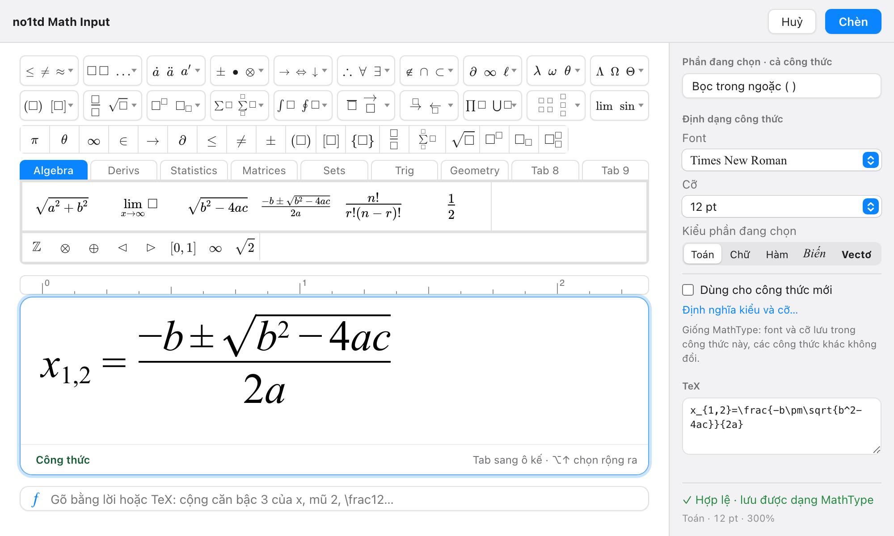

# no1td Math Input: soạn công thức toán kiểu MathType cho Word trên Mac

**no1td Math Input** là app soạn công thức toán cho **Microsoft Word trên Mac**, dùng như MathType 7. Công thức chèn vào Word là **object MathType** (`Equation.DSMT4`), nên:

- máy có MathType (Windows hay Mac) mở và sửa được như công thức MathType thường;
- đề cũ soạn bằng MathType mở và sửa được bằng no1td Math Input;
- gửi tệp Word cho người khác như bình thường, không cần họ cài gì thêm.

## Tải về

Tải bản mới nhất ở trang [Releases](https://github.com/sonbnha/no1td-math-input/releases/latest):

- **no1td-Math-Input-0.2.0.pkg**: trình cài, nên dùng;
- **no1td-Math-Input-0.2.0.dmg**: kéo thả vào Applications.

Yêu cầu: Mac chip Apple (M1 trở lên), macOS 13 trở lên, Microsoft Word for Mac.

## Tính năng

### Trình soạn như MathType 7

- Cửa sổ giống MathType 7: 2 hàng bảng ký hiệu và mẫu, thanh nhỏ, 9 tab biểu thức (Algebra, Derivs, Statistics, Matrices, Sets, Trig, Geometry, Tab 8, Tab 9), thước.
- Ô trống khung chấm, con trỏ có chân, vùng chọn màu xanh, Tab sang ô kế, ⌫ chọn cả mẫu trước khi xoá: thao tác như MathType 7.
- Phím tắt của MathType: Ctrl+F phân số, Ctrl+R căn, Ctrl+H mũ, Ctrl+L chỉ số dưới, Ctrl+9 ngoặc, Ctrl+I tích phân, Ctrl+G chữ Hy Lạp… (⌘/ xem tất cả).
- Kiểu chữ (Toán, Chữ, Hàm, Biến, Vectơ), Định nghĩa kiểu và cỡ, cỡ chỉ số 58%, 42% như MathType; font và cỡ lưu trong từng công thức.
- Hệ phương trình ngoặc { và ngoặc [, ma trận, Enter thêm dòng, nút thêm / xoá hàng, cột.
- **Gõ bằng lời**: "x mũ 2 cộng 1", "căn bậc 3 của x", "(x^2-2) phần (xsinx)", "1/2"… hoặc gõ TeX, ra công thức ngay.
- Lưu công thức hay dùng vào Tab 8 (⌘D).

### Trong Word (tab "no1td Math Input" trên Ribbon)

- **Chèn** công thức trong dòng, **Chèn riêng dòng**, **Đánh số** công thức (kèm Cập nhật số).
- **Sửa**: click đúp vào công thức, hoặc bấm nút Sửa công thức có trên mọi tab của Word.
- **TeX → MathType**: đổi các đoạn `$…$`, `\(…\)`, `$$…$$`, `\[…\]` thành công thức.
- **Vẽ lại công thức**: làm đồng bộ mọi công thức MathType trong đề (giữ font và cỡ của từng công thức, hoặc dùng mặc định).
- **Sang MathType**: đổi Word Equation và công thức của MathType Add-in (Microsoft 365) thành công thức MathType.
- **Sang Word Equation**, **Công thức trước / sau**.

### Ở mọi app

- **Chèn nhanh (⌥Space)**: mở một ô gõ nhỏ ở bất kỳ app nào, gõ tên công thức, đọc bằng lời hoặc TeX, Enter là dán công thức vào chỗ đang gõ. Đổi phím trong Cài đặt.
- **Sao chép** trong app rồi ⌘V vào Word: ra công thức MathType. Dán vào app khác thì ra mã TeX.

### Cài đặt từng bước

Lần đầu mở app, cửa sổ **Chào mừng** đi qua từng bước: cài add-in cho Word, cho phép Trợ năng và điều khiển Word (để click đúp mở công thức), chọn phím Chèn nhanh và mở cùng máy, chọn font và cỡ cho công thức mới. Thiếu gì về sau (add-in cũ, quyền bị tắt) thì cửa sổ hiện lại đúng bước đó. Mở lại lúc nào cũng được: **Trợ giúp → Hướng dẫn cài đặt**.

## Cài đặt

1. Mở **no1td-Math-Input-0.2.0.pkg** và làm theo trình cài. Trình cài đặt app vào Applications rồi mở app.
   Dùng tệp .dmg thì kéo **no1td Math Input** vào Applications, rồi bấm chuột phải vào app → **Mở** → **Mở** (bản này chưa được Apple xác minh).
2. Làm theo cửa sổ **Chào mừng**: bấm **Cài add-in**; nếu macOS hỏi quyền ghi vào thư mục của Microsoft Office, chọn **Cho phép**.
3. Thoát hẳn Word (⌘Q) rồi mở lại: Ribbon có tab **no1td Math Input**.

Chi tiết xem tệp "Hướng dẫn cài đặt.txt" trong tệp .dmg.

### Font của MathType

Đề soạn bằng MathType trên Windows hay dùng font **Euclid, Euclid Symbol, Tiger…**. Máy chưa có các font này thì Word vẽ sai vài ký hiệu (ví dụ 4° thành 4∝). Các font này thuộc MathType nên không kèm trong bộ cài. Nếu bạn có MathType, chép các tệp font đó (trên Windows: `C:\Windows\Fonts`) rồi cài ở **Cài đặt (⌘,) → Font → Cài từ thư mục…**, sau đó mở lại Word.

## Cập nhật từ no1td Math 0.1.x

Từ bản 0.2.0, app đổi tên thành **no1td Math Input**. Trình cài .pkg tự thay bản "no1td Math" cũ; cài đặt và công thức đã lưu của bạn giữ nguyên. Sau khi cài, bấm **Cập nhật** add-in ở cửa sổ Chào mừng rồi mở lại Word: tab trên Ribbon đổi thành "no1td Math Input".

## Đã kiểm tra

- MathType 7 trên Windows mở và lưu lại đủ 394/394 công thức do no1td Math Input tạo.
- Trong MathType 7, click đúp mở đúng 107/107 công thức mẫu; sửa rồi lưu lại 11/11.
- Word for Mac 16.113 trên Mac chip Apple.

## Giới hạn đã biết

- Chưa ký Developer ID và chưa notarize: lần đầu mở tệp .dmg phải bấm chuột phải → Mở.
- Chưa chạy trên Mac Intel.
- Chưa có vài ký hiệu hiếm trong các tab của MathType (𝕜 𝔽 ⊸ ⋐ ⋑ ⊏ ⊐ ▲ ▱…) và đường kẻ chia ma trận.

## Phản hồi

Gặp lỗi hoặc cần thêm tính năng: mở mục [Issues](https://github.com/sonbnha/no1td-math-input/issues).

Repo này chỉ chứa giới thiệu, gói cài đặt và ghi chú phát hành.
